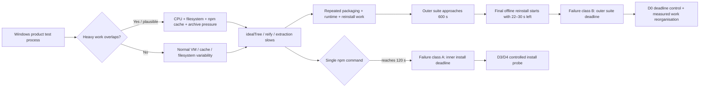
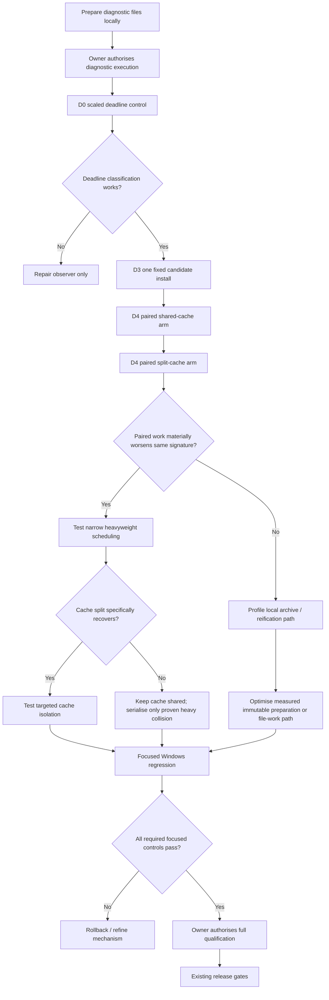
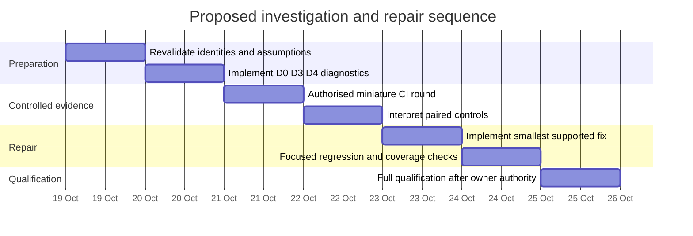

# Windows CI Timeout Diagnosis and Recovery Plan for Markdown Quality

## Executive summary

The attached brief is unusually strong: it separates two materially different timeout classes, preserves exact-source run evidence, identifies the relevant harness boundaries, and explicitly prohibits the most tempting but least informative responses—raising thresholds, retrying whole commands, rerunning the full matrix, or attributing the problem to npm without a controlled trigger. The research objective is therefore not “make CI green”; it is to establish a falsifiable mechanism and make the smallest change that restores reliable qualification without weakening correctness, security, or the existing release authority model. [Brief, lines 3–31](sandbox:/mnt/data/2026-10-17-windows-ci-timeout-expert-brief.md)

**The evidence supports one high-confidence diagnosis and one moderate-confidence diagnosis.**

**The 600-second failures are predominantly cumulative-work/outer-deadline failures, not evidence that the final offline `npm ci` is hung.** On Windows Node 22.23.3 and 24.0.0, the final offline reinstall began with only about 22.15 and 30.18 seconds of the 600-second suite window remaining. Earlier offline reinstalls in the same tests had completed normally in 35.29 and 41.60 seconds. The outer deadline could therefore kill an entirely ordinary final reinstall before that reinstall approached its own 120-second command limit. This conclusion is high confidence. [Brief, lines 77–100](sandbox:/mnt/data/2026-10-17-windows-ci-timeout-expert-brief.md)

**The 120-second installation failures are best explained at present as low-headroom local installation work on variable Windows-hosted VMs, plausibly amplified by overlapping packing/install/extraction activity; a specific npm defect, registry outage, or cache race has not been established.** Two concurrently eligible product tests failed at 120.034 and 120.203 seconds with remarkably similar completed `idealTree`/`reifyNode` profiles. A locally supplied native archive itself spent roughly 47 seconds in `reifyNode`, which weakens a network-only explanation. Yet a same-source Node 26/npm 11.20.0 Windows job passed, and separate consumer jobs have also exhibited 120-second failures. The parsimonious working model is therefore **insufficient performance margin plus variable local filesystem/reification cost, with in-job contention as an amplifier rather than a proven sole cause**. Confidence is moderate. [Brief, lines 52–75, 102–122, 302–324](sandbox:/mnt/data/2026-10-17-windows-ci-timeout-expert-brief.md)

The existing limits should not be changed as the first repair. A successful root install is already consuming approximately **60–92 seconds of a 120-second budget**, leaving only 28–60 seconds of headroom; a previous successful suite consumed **587.4 of 600 seconds**, leaving about 12.6 seconds, or only 2.1%, of suite margin. Conversely, the 30-second corpus gate currently has substantial headroom: latest maxima were approximately 10.1–18.3 seconds, with all measured memory gates passing. The performance/corpus issue is therefore not the present release blocker. [Brief, lines 124–141, 314–343](sandbox:/mnt/data/2026-10-17-windows-ci-timeout-expert-brief.md)

The recommended path is:

1. **Do not change production timeout values yet.**
2. **Do not globally set `--test-concurrency=1`.** Existing local evidence does not support it as a general repair; the cited three-file run actually took longer overall when serialised. [Brief, lines 314–319](sandbox:/mnt/data/2026-10-17-windows-ci-timeout-expert-brief.md)
3. Add one opt-in, read-only Windows diagnostic workflow with three narrow cases: a scaled nested-deadline control; one fixed-archive consumer installation; and a controlled one-versus-two-process/cache-isolation comparison.
4. If paired installation reproducibly degrades the same install phases, **narrowly schedule only the heavyweight package-install fixtures rather than serialising the whole test suite**.
5. Independently reduce repeated immutable package preparation where semantic coverage permits. Do not drop the distinct root/isolated, offline, bundle-integrity, tamper, SBOM, audit, and public-runtime controls.
6. Preserve the 600-second **aggregate** test obligation while changing how work is organised. Splitting the suite into unrelated fresh 600-second windows would conceal the existing contract rather than repair the harness. [Brief, lines 497–519](sandbox:/mnt/data/2026-10-17-windows-ci-timeout-expert-brief.md)
7. Keep dependency/security replacement work separate. The brief itself says the upstream range must be freshly revalidated before proposing an upgrade; this research did not establish a sufficiently verified current upstream replacement to justify coupling that change to the CI fix. [Brief, lines 240–262](sandbox:/mnt/data/2026-10-17-windows-ci-timeout-expert-brief.md)

The fastest credible programme is approximately **three to five engineer-days**, excluding any owner-imposed waiting between authorised CI runs. The first diagnostic round should be only two or three Windows jobs and should finish in roughly five to eight minutes per job by design, instead of triggering the full release matrix. No larger paid runner, Enterprise feature, PR requirement, weakened integrity check, disabled endpoint protection, or publication is required. [Brief, lines 378–430](sandbox:/mnt/data/2026-10-17-windows-ci-timeout-expert-brief.md)



## Brief interpretation, scope and decision criteria

### Objectives and deliverables

The requested outcome is an evidence-backed diagnosis of the Windows CI failures, ranked remedies, and small remote experiments that distinguish competing mechanisms without another cycle of broad, slow qualification. The expert deliverable must include runnable miniature tests, a minimal manually dispatched workflow, hypotheses and falsification conditions, preserved coverage, timing-contract analysis, rollback, and a bounded progression from miniature reproduction to one real-package test before any renewed full release qualification. [Brief, lines 3–27, 509–527](sandbox:/mnt/data/2026-10-17-windows-ci-timeout-expert-brief.md)

The problem under study is frozen to commit `2f4718f05df9565ba9d9bb0f14ef56f0ca93a539`, tree `17b53b7181ccd3dbd42480245aa9b68b9d90163b`. The latest evidence contains both failing and passing Windows cells from that source, which is essential because it demonstrates intermittency without allowing a green sibling to invalidate a failed gate. [Brief, lines 33–50](sandbox:/mnt/data/2026-10-17-windows-ci-timeout-expert-brief.md)

### Scope and stakeholders

The operational stakeholder is the **sole maintainer/owner**, whose direct-to-main workflow and deliberate release approval must remain intact. The technical audience is an engineer specialising in npm/Arborist, Windows process/filesystem behaviour, and CI performance diagnosis. Release approval and the unresolved OPEN-010 decision remain separate authorities from investigation and implementation. Security, SBOM/distribution validation, corpus performance, candidate consumer qualification, and product tests are independent gates rather than interchangeable evidence. [Brief, lines 3–4, 29–31, 124–141](sandbox:/mnt/data/2026-10-17-windows-ci-timeout-expert-brief.md)

The build stop is an explicit constraint. Creating a diagnostic workflow does **not** authorise pushing it or dispatching it; a source change can itself trigger existing push workflows. Accordingly, the implementation artefact can be prepared locally, but hosted execution requires renewed owner authority. [Brief, lines 11–14, 423–430](sandbox:/mnt/data/2026-10-17-windows-ci-timeout-expert-brief.md)

### Constraints and success metrics

The brief fixes important non-negotiables:

| Dimension                      | Required position                                                                                                              |
| ------------------------------ | ------------------------------------------------------------------------------------------------------------------------------ |
| Install command                | Preserve the 120,000 ms product responsiveness/runaway guard during diagnosis                                                  |
| Top-level Node test invocation | Preserve the 600,000 ms aggregate obligation unless the owner separately changes the measurement contract                      |
| Corpus                         | Preserve 30,000 ms per complete observation and existing memory limits                                                         |
| Installation                   | `--ignore-scripts`; no automatic outer-command retry                                                                           |
| Integrity/security             | Preserve archive identities, lock/integrity checks, bundle inventory, recipient audit, SBOM reconciliation and tamper controls |
| Workflow                       | Sole-maintainer/direct-main model; deliberate release approval                                                                 |
| Infrastructure                 | No requirement for Enterprise, larger paid runner, preview feature or disabled endpoint protection                             |
| Diagnosis                      | Small falsifiable cases; do not rerun the entire workflow merely to acquire another intermittent sample                        |
| Publication                    | Not required and not authorised by diagnostic work                                                                             |

These constraints are explicit in the brief. [Brief, lines 23–31, 170–188, 326–357, 497–527](sandbox:/mnt/data/2026-10-17-windows-ci-timeout-expert-brief.md)

Several success metrics, however, are **unspecified** and should not be invented. In particular, the brief does not specify an acceptable long-run CI false-timeout rate, a p95/p99 install latency target, a monetary CI budget, or a deadline for completing the investigation. Six corpus samples are explicitly recognised as a sample maximum rather than a population-tail estimate. [Brief, lines 124–139, 336–343](sandbox:/mnt/data/2026-10-17-windows-ci-timeout-expert-brief.md)

For this investigation, the practical acceptance metrics should therefore be:

| Investigation outcome  | Acceptance criterion                                                                                                |
| ---------------------- | ------------------------------------------------------------------------------------------------------------------- |
| Failure classification | Diagnostic output states unambiguously whether an inner 120 s command deadline or aggregate outer deadline fired    |
| Reproduction           | At least one small case reproduces or falsifies the predicted mechanism without the full qualification matrix       |
| Fix specificity        | The selected intervention changes one supported causal variable and has a matched control                           |
| Performance            | Product installs continue to be judged against 120 s; corpus continues to satisfy 30 s                              |
| Correctness            | Root and isolated installation, public CLI/API semantics, offline behaviour and cleanup remain covered              |
| Supply chain           | Exact source/archive identity, bundle inventory, dependency edges, audit/tamper/SBOM requirements remain covered    |
| CI reliability         | The repaired focused Windows regression passes the required Node cells before a final authorised full qualification |
| Governance             | No release, stage or publication occurs as an implicit consequence of diagnostic success                            |

### Source priority

The source hierarchy for conclusions in this report is:

**First**, exact commit-pinned project source and exact GitHub Actions logs from the frozen source. **Second**, official Node.js documentation for the test runner and child-process deadline semantics; official npm documentation for `npm ci`, request configuration and root override semantics; npm/cli Arborist source matching the actual npm version; and official GitHub documentation for hosted-runner characteristics. **Third**, historical project records for understanding how earlier fixes changed workload. Generic blog posts and unrelated npm issues are insufficient to establish this incident's cause. This matches the brief's own evidence rules. [Brief, lines 143–192, 326–376](sandbox:/mnt/data/2026-10-17-windows-ci-timeout-expert-brief.md)

The authoritative upstream facts cited by the brief include Node's documented dependence of CLI test concurrency on available parallelism; npm's distinction between frozen `npm ci` and network-independent `--offline`; and Arborist's distinct ideal-tree and reification phases. These definitions explain why a timing labelled `reifyNode` is not a pure network timer and why an offline reinstall can still spend substantial time in dependency-tree and filesystem work. [Brief, lines 159–183, 345–357](sandbox:/mnt/data/2026-10-17-windows-ci-timeout-expert-brief.md)

## Evidence, diagnosis and quantitative assessment

### Failure class A: 120-second installation deadline

The latest manual Windows Node 26.12.0/npm 11.20.0 job contains two separate installation failures:

| Failing operation                            | Observed elapsed | Relevant completed timings                                                                      |
| -------------------------------------------- | ---------------: | ----------------------------------------------------------------------------------------------- |
| `packaging.test.js` consumer install         |        120.034 s | native package `reifyNode` 47.183 s; `idealTree:buildDeps` 38.291 s; `idealTree:#root` 36.228 s |
| `packed-qualification.test.js` fresh install |        120.203 s | native package `reifyNode` 47.666 s; `idealTree:buildDeps` 38.691 s; `idealTree:#root` 36.708 s |

Both are **deadline-censored observations**: they prove the command did not complete by 120 seconds; they do not show how long the installation would have taken if permitted to continue. The suite itself exited after about 382.8 seconds, so this was not the 600-second failure class. [Brief, lines 52–75](sandbox:/mnt/data/2026-10-17-windows-ci-timeout-expert-brief.md)

The striking similarity of the two profiles justifies testing shared local resource pressure. Because the long-running native package is supplied via a local archive, its approximately 47-second `reifyNode` interval cannot sensibly be equated with “47 seconds downloading that package”. Arborist reification encompasses local package installation work, and the absence of a completion timer for the package being processed when a process is killed does not identify exactly where it was blocked. [Brief, lines 71–75, 351–353](sandbox:/mnt/data/2026-10-17-windows-ci-timeout-expert-brief.md)

There is nevertheless strong counterevidence against a deterministic Node/npm combination defect. A same-source Windows Node 26.12.0/npm 11.20.0 sibling job passed all 530 tests in about 505.4 seconds on the same image version, although on a different VM/region. Earlier independent consumer jobs have also hit the 120-second boundary, so concurrent full-product tests are not a necessary condition. [Brief, lines 102–122, 302–312](sandbox:/mnt/data/2026-10-17-windows-ci-timeout-expert-brief.md)

**Diagnosis: moderate confidence.** The primary working hypothesis should be **a high-I/O/high-file-count installation workload operating too close to the 120-second ceiling on variable Windows hosted VMs, sometimes worsened by concurrent packaging, extraction or cache activity**. Cache contention is plausible but unproved. Registry latency can contribute to online installs but cannot explain every offline/local workload observation. A specific npm implementation bug is not established.

### Failure class B: aggregate 600-second suite deadline

The outer-deadline case is materially clearer:

| Packaging phase                             | Node 22.23.3 | Node 24.0.0 |
| ------------------------------------------- | -----------: | ----------: |
| Pack archives                               |     32.793 s |    30.907 s |
| Inspect shipment                            |     29.466 s |    34.050 s |
| Root install                                |     88.831 s |    91.587 s |
| Root runtime qualification                  |    109.124 s |    91.846 s |
| Root offline reinstall                      |     35.286 s |    41.598 s |
| Isolated install                            |     40.099 s |    57.042 s |
| Isolated runtime qualification              |     68.959 s |    61.105 s |
| Final isolated offline reinstall            |      started |     started |
| Top-level deadline                          |    600.012 s |   600.009 s |
| Time apparently remaining after final start |     ~22.15 s |    ~30.18 s |

The final command's own deadline was still 120 seconds, but its parent process could offer only roughly 22–30 seconds before the parent deadline fired. Previous offline reinstalls in the same cases had already required 35–42 seconds. The evidence therefore explains the observed failure without requiring any new defect in the final reinstall. [Brief, lines 77–100](sandbox:/mnt/data/2026-10-17-windows-ci-timeout-expert-brief.md)

There is a second important quantitative observation. The explicitly listed completed phases account for about **404.6 seconds** in the Node 22 case and **408.1 seconds** in the Node 24 case, while the last offline reinstall did not start until roughly 577.8 and 569.8 seconds after the suite window began. Roughly **162–173 seconds of the outer budget is therefore outside those listed phase durations**. That interval can include top-level scheduling/queue delay, other tests and setup work, uninstrumented fixture work, and reporter/timestamp effects; it should not be assigned to one mechanism without further measurement. It is, however, large enough to make “optimise the final `npm ci`” an incomplete repair strategy. The brief itself warns that dequeue events and phase end markers are not a complete critical-path profile. [Brief, lines 83–100, 434–455](sandbox:/mnt/data/2026-10-17-windows-ci-timeout-expert-brief.md)

A previous successful Windows Node 22 suite took **587.428 seconds**, leaving only **12.572 seconds, or approximately 2.1%, of a 600-second budget**. The latest passing Node 26 suite was healthier at about 505.4 seconds, leaving 94.6 seconds. This variance is why the outer timeout should be regarded as a cumulative-work budget, not evidence that whichever subprocess happens to be active at 600 seconds is defective. [Brief, lines 102–117, 314–319](sandbox:/mnt/data/2026-10-17-windows-ci-timeout-expert-brief.md)

**Diagnosis: high confidence.** The direct mechanism is aggregate test workload plus scheduling exhausting the outer deadline. A lifecycle defect may exist elsewhere, but is not needed to explain these two failures.

### Current timing-contract headroom

| Contract                         | Relevant observations                                                      | Headroom assessment                                               | Recommendation                                                             |
| -------------------------------- | -------------------------------------------------------------------------- | ----------------------------------------------------------------- | -------------------------------------------------------------------------- |
| HTTP read: 15 s, bounded retries | Synthetic stalled-response fixture was recovered by bounded request policy | Applies only to network request behaviour                         | Keep; do not infer whole-install guarantee                                 |
| Install: 120 s                   | Successful root installs around 60–92 s; failures at ~120 s                | 28–60 s observed success margin; tail behaviour not characterised | Keep unchanged while D3/D4 establish distribution/mechanism                |
| Suite: 600 s                     | successes at ~505 s and ~587 s; failures at 600 s                          | One known success had only 12.6 s / 2.1% margin                   | Reorganise work first; contract change, if any, is separate owner decision |
| Corpus: 30 s                     | current maxima 10.09–18.26 s                                               | about 11.7–19.9 s remaining                                       | Keep unchanged                                                             |
| Process-tree memory: 512 MiB     | current sampled maxima ~347–456 MiB depending corpus/platform metric       | Current cited runs pass                                           | Keep; metrics are platform-specific                                        |

The request-recovery change remains valid within its demonstrated scope: it corrected a synthetic stalled HTTP-response condition without adding whole-command retries. It never proved that registry latency caused the hosted failures. [Brief, lines 227–238](sandbox:/mnt/data/2026-10-17-windows-ci-timeout-expert-brief.md)

The bundle-staging reduction also remains valid: narrowing a producer staging manifest to the one closure actually being bundled eliminated demonstrably unnecessary producer-side work, with a local 79-package acquisition reported at 812 ms. It cannot remove legitimate downstream consumer dependencies or whole-consumer validation cost. [Brief, lines 264–273](sandbox:/mnt/data/2026-10-17-windows-ci-timeout-expert-brief.md)

Likewise, the two fixture lifecycle repairs were real bugs and should remain. They address missed child completion and cleanup-ordering defects, but the latest timeout evidence shows active packaging/install work rather than an idle leaked server, so those fixes should not be mislabelled as the explanation for the present failures. [Brief, lines 275–284](sandbox:/mnt/data/2026-10-17-windows-ci-timeout-expert-brief.md)

### Ranked causal hypotheses

| Rank | Hypothesis                                                    | Evidence for                                                                                                                            | Evidence against / gap                                                                                   | Confidence                |
| ---- | ------------------------------------------------------------- | --------------------------------------------------------------------------------------------------------------------------------------- | -------------------------------------------------------------------------------------------------------- | ------------------------- |
| A    | Cumulative work/scheduling consumes 600 s                     | Final offline install receives only 22–30 s; earlier equivalent operations need 35–42 s; 587 s previous pass                            | Does not explain independent 120 s install failures                                                      | **High** for failure B    |
| B    | Windows filesystem/reification pressure plus low SLO headroom | Two simultaneous-looking installs have near-identical slow profiles; local archive itself spends ~47 s in reify; packing varies greatly | No controlled one-vs-two comparison yet; consumer-only jobs can fail                                     | **Moderate-high**         |
| C    | Heavy bundled/high-member package increases installation cost | 79-package bundled closure; core archive has 1,369 members; native archive expands to ~45.8 MB; repeated pack/install/delete cycles     | Correctness-preserving work is expected; no controlled pre/post hosted result                            | **Moderate**              |
| D    | Shared npm cache contention                                   | Commands inherit same ordinary cache and multiple installs may overlap                                                                  | No lock/corruption signature; isolated consumer can fail; cold caches may be worse                       | **Moderate-low until D4** |
| E    | Registry/metadata latency                                     | Historical `idealTree:buildDeps` reached ~97 s; online consumers have unbundled dependencies                                            | Latest failures include large local reification cost and offline failures; bounded request fixtures pass | **Moderate-low**          |
| F    | npm-version/image-specific defect                             | Image is a variable; npm versions differ                                                                                                | Failures span npm 10.9.9, 11.3.0, 11.20.0, while same npm/image family can pass                          | **Low-moderate**          |
| G    | Current lifecycle leak                                        | Prior lifecycle defects were real                                                                                                       | Latest failures occur during measured package work; relevant fixture tests now pass                      | **Low**                   |
| H    | Renewed Markdown runtime regression                           | Runtime qualification is non-trivial aggregate work                                                                                     | Current corpus gates pass with complete parity                                                           | **Low**                   |

This ranking is deliberately stronger than simply copying the brief's candidate list: it treats cumulative outer-budget exhaustion as diagnosed, while keeping the detailed mechanism behind 120-second installs open. [Brief, lines 359–376](sandbox:/mnt/data/2026-10-17-windows-ci-timeout-expert-brief.md)

## Gap analysis, options and risk assessment

### Material evidence gaps

The investigation still lacks four facts required for a root-cause claim.

First, there is no controlled **one installation versus two simultaneous installations** experiment using identical archives and graph state. Consequently, “contention” remains a hypothesis rather than a diagnosis. [Brief, lines 363–370](sandbox:/mnt/data/2026-10-17-windows-ci-timeout-expert-brief.md)

Second, cache restoration, cache population and cache concurrency are not the same variable. The product workflow may not restore an Actions package-manager cache, yet the initial native npm installation can warm npm's ordinary cache for later tests. A comparison must therefore record the cache directory and pre-state and vary shared versus separate cache paths independently of process concurrency. [Brief, lines 159–181](sandbox:/mnt/data/2026-10-17-windows-ci-timeout-expert-brief.md)

Third, present diagnostics preserve completed npm timers but not a complete critical path. Nested `idealTree` and concurrent `reifyNode` timings cannot simply be summed, a killed process may not flush its final timing data, and successful stderr is currently discarded. The next observer needs enough external information to distinguish CPU, filesystem waiting, cache access and command termination without turning the diagnostic lane into another heavyweight system. [Brief, lines 434–455](sandbox:/mnt/data/2026-10-17-windows-ci-timeout-expert-brief.md)

Fourth, the brief asks that upstream package/advisory state be refreshed before replacing the temporary vendored metadata repair. That refresh did not yield sufficiently reconciled evidence during preparation of this report to justify a dependency change. **Upstream replacement status is therefore treated as unspecified rather than assumed.** A dependency upgrade should not be bundled into the timeout repair merely because it is attractive maintenance work. [Brief, lines 240–262](sandbox:/mnt/data/2026-10-17-windows-ci-timeout-expert-brief.md)

The candidate artefact is similarly required to be revalidated by ID and digest before use; the brief expressly prohibits silently substituting “latest”. This report therefore treats availability of artefact ID `12089857699` at execution time as **unconfirmed**. [Brief, lines 457–484](sandbox:/mnt/data/2026-10-17-windows-ci-timeout-expert-brief.md)

### Options

| Option                                          | Expected value                                                     | Main risk                                                                                       | Recommendation                                        |
| ----------------------------------------------- | ------------------------------------------------------------------ | ----------------------------------------------------------------------------------------------- | ----------------------------------------------------- |
| Raise 120 s install timeout                     | Immediate reduction in timeout failures                            | Masks degraded installation; weakens explicit product guard without explaining cause            | **Reject as first repair**                            |
| Raise/split 600 s suite timeout                 | Prevents current outer interruption                                | Can conceal growing work and silently multiply allowed budget                                   | **Reject as standalone repair**                       |
| Whole-command retry                             | May turn intermittent red to green                                 | Doubles expensive work and destroys first-failure evidence                                      | **Reject**                                            |
| Global `--test-concurrency=1`                   | Removes top-level overlap                                          | Existing local comparison became slower overall; may still leave individual installs near 120 s | **Reject as blanket fix**                             |
| Narrow scheduling of heavyweight package tests  | Removes suspected overlap while preserving normal test parallelism | Could increase critical path if overlap is not the problem                                      | **Recommended only after D4 evidence**                |
| Share immutable preparation between tests       | Removes duplicate pack/copy/hash work                              | Can accidentally collapse independent admission/security boundaries                             | **Recommended where coverage map proves equivalence** |
| Separate npm caches                             | Tests cache contention cleanly                                     | Cold caches can create a new bottleneck; copying/seeding can confound measurement               | **Diagnostic intervention, not presumed fix**         |
| Optimise measured archive/file-count bottleneck | Directly reduces installation work                                 | Requires proof of where time is spent                                                           | **Likely durable fix if D2/D4 confirm**               |
| Upgrade upstream dependency                     | Could eliminate vendored bundle repair and its cost                | Current suitable upstream state not established; mixes security graph change with CI diagnosis  | **Defer**                                             |
| Dedicated larger runner                         | More resources                                                     | Explicitly outside brief constraints and does not explain current supported runner behaviour    | **Reject**                                            |

The best architectural principle is to **separate work organisation from acceptance limits**. A test scheduler may prevent expensive integration tests from colliding while still measuring all required work against one aggregate 600-second deadline. That is materially different from giving every split test a fresh 600 seconds.

### Recommended production repair shape

Assuming the contention experiment confirms that simultaneous heavyweight tests materially inflate installation phases, the least disruptive production change is:

**Keep the existing generic test suite parallel, but put only heavyweight packaging/install fixtures behind a narrow scheduler or semaphore. Preserve one monotonic 600-second outer deadline.**

The scheduler should start one 600-second clock, run the heavyweight package-install tests in a controlled order, and then run—or interleave where evidence says safe—the rest of the suite. Every child command retains its current 120-second install or other operation-specific limit. The scheduler must propagate the **remaining outer budget** rather than resetting the parent allowance for each test.

This approach directly repairs the suspected resource collision while satisfying the brief's warning not to “silently convert one 600-second obligation into several permissive windows”. [Brief, lines 497–507](sandbox:/mnt/data/2026-10-17-windows-ci-timeout-expert-brief.md)

The next optimisation target should be **repeated immutable preparation**, not required behavioural checks. Packaging, independent shipment inspection, separate frozen-producer packing, multiple fresh installations, repeated runtime qualification, offline reinstallation and cleanup all carry legitimate coverage, but some immutable archive creation/hash/inventory work may be shareable after identity is established. Any such change needs the coverage map below.

| Existing obligation                           | May share preparation?                                                                   | Must remain independently asserted? |
| --------------------------------------------- | ---------------------------------------------------------------------------------------- | ----------------------------------- |
| Frozen source identity                        | Yes, once cryptographically bound                                                        | Yes                                 |
| Candidate archive bytes/hash                  | Yes                                                                                      | Yes                                 |
| Independent architecture/admission assertions | Preparation may be reused                                                                | Yes                                 |
| Root fresh install                            | No substitute with existing `node_modules`                                               | Yes                                 |
| Isolated consumer install                     | No                                                                                       | Yes                                 |
| `--ignore-scripts`                            | N/A                                                                                      | Yes                                 |
| Offline reinstall                             | Seed state may be prepared                                                               | Yes                                 |
| Bundle inventory/origin/tamper controls       | Immutable inventory may be reused                                                        | Yes                                 |
| Dependency-edge validity / `npm ls`           | No                                                                                       | Yes                                 |
| Recipient audit and SBOM reconciliation       | Inputs may be reused                                                                     | Yes                                 |
| Public CLI/API behaviour                      | Installed fixture can host several assertions where cold-process semantics are preserved | Yes                                 |
| Cleanup/descendant ownership                  | No                                                                                       | Yes                                 |

## Minimal diagnostic harness and runnable remote tests

The first authorised remote round should contain **D0, D3 and D4 only**. D0 proves that the diagnostic apparatus differentiates inner and outer deadlines. D3 establishes a fixed-archive actual-package baseline. D4 changes concurrency/cache state against the same archive and graph. No corpus checkout, candidate rebuild or full release workflow is required. This directly follows the brief's requested progression. [Brief, lines 378–430](sandbox:/mnt/data/2026-10-17-windows-ci-timeout-expert-brief.md)

### Nested-deadline control

The first file deliberately produces an operation that can either complete or exceed a parent window.

```js
// diagnostics/deadline-child.mjs
import { setTimeout as sleep } from 'node:timers/promises';

const delay = Number.parseInt(process.argv[2] ?? '1000', 10);

if (!Number.isFinite(delay) || delay < 0) {
  console.error('delay must be a non-negative integer');
  process.exit(2);
}

const started = process.hrtime.bigint();
await sleep(delay);

const elapsedMs = Number(process.hrtime.bigint() - started) / 1e6;
process.stdout.write(`${JSON.stringify({
  event: 'child-complete',
  elapsedMs,
  pid: process.pid,
})}\n`);
```

The meta-test supervises the child externally rather than trying to schedule a JavaScript timeout from inside a process blocked in `spawnSync`. That distinction is required by the brief. [Brief, lines 434–455](sandbox:/mnt/data/2026-10-17-windows-ci-timeout-expert-brief.md)

```js
// diagnostics/deadline-meta.test.mjs
import assert from 'node:assert/strict';
import { spawn } from 'node:child_process';
import { test } from 'node:test';
import { performance } from 'node:perf_hooks';

function runChild({ delayMs, parentDeadlineMs }) {
  return new Promise((resolve, reject) => {
    const started = performance.now();
    const child = spawn(
      process.execPath,
      [new URL('./deadline-child.mjs', import.meta.url).pathname, String(delayMs)],
      {
        windowsHide: true,
        stdio: ['ignore', 'pipe', 'pipe'],
      },
    );

    let stdout = '';
    let stderr = '';
    let deadlineFired = false;

    child.stdout.setEncoding('utf8');
    child.stderr.setEncoding('utf8');
    child.stdout.on('data', chunk => { stdout += chunk; });
    child.stderr.on('data', chunk => { stderr += chunk; });

    const timer = setTimeout(() => {
      deadlineFired = true;

      if (process.platform === 'win32' && child.pid) {
        const killer = spawn(
          'taskkill.exe',
          ['/PID', String(child.pid), '/T', '/F'],
          { windowsHide: true, stdio: 'ignore' },
        );
        killer.once('error', reject);
      } else {
        child.kill('SIGTERM');
      }
    }, parentDeadlineMs);

    child.once('error', reject);
    child.once('close', (code, signal) => {
      clearTimeout(timer);
      resolve({
        code,
        signal,
        deadlineFired,
        elapsedMs: performance.now() - started,
        stdout,
        stderr,
      });
    });
  });
}

test('outer deadline interrupts otherwise-valid child', async () => {
  const result = await runChild({
    delayMs: 4_000,
    parentDeadlineMs: 1_500,
  });

  assert.equal(result.deadlineFired, true);
  assert.equal(result.stdout.includes('child-complete'), false);
});

test('same child completes when outer budget is sufficient', async () => {
  const result = await runChild({
    delayMs: 1_000,
    parentDeadlineMs: 4_000,
  });

  assert.equal(result.deadlineFired, false);
  assert.equal(result.code, 0);
  assert.match(result.stdout, /child-complete/);
});
```

Copyable command:

```text
node --test diagnostics/deadline-meta.test.mjs
```

Target budget: below 10 seconds. Passing requires both the intentional outer-deadline case and normal completion case to behave exactly as asserted; the workflow itself does not use `continue-on-error` to disguise the failing child. This follows D0's specified acceptance model. [Brief, lines 384–398](sandbox:/mnt/data/2026-10-17-windows-ci-timeout-expert-brief.md)

### Actual-package single and paired install probe

The actual-package probe should use **only previously produced, hash-bound archives**. According to the brief, the relevant Windows artefacts are:

| Archive                                                  | Required SHA-256                                                   |
| -------------------------------------------------------- | ------------------------------------------------------------------ |
| `hadden-industries-markdown-quality-1.0.3.tgz`           | `ed51524fc5fd0d838e2cfeaf060f54f81f5a9f62eadc75202078fb92af2b2300` |
| `hadden-industries-markdown-quality-win32-x64-1.0.3.tgz` | `5660e39295c840ddcd4cdab7770bf0c618ed2b770c039bdaf187ea10799b6062` |

The retained candidate is explicitly **not equivalent to the public immutable npm package carrying the same filename version**, so the probe must not replace it with `npm install ...@1.0.3`. [Brief, lines 457–484](sandbox:/mnt/data/2026-10-17-windows-ci-timeout-expert-brief.md)

A compact supervisor can use one process for D3 and two processes for D4. Its diagnostic wrapper is intentionally asynchronous; this differs from the production `spawnSync` path so that timing and termination can be observed externally.

```js
// diagnostics/install-probe.mjs
import {
  createHash,
} from 'node:crypto';
import {
  mkdtemp,
  mkdir,
  readFile,
  rm,
  writeFile,
} from 'node:fs/promises';
import { createReadStream } from 'node:fs';
import { tmpdir } from 'node:os';
import { basename, join, resolve } from 'node:path';
import { spawn } from 'node:child_process';
import { performance } from 'node:perf_hooks';

const EXPECTED = new Map([
  [
    'hadden-industries-markdown-quality-1.0.3.tgz',
    'ed51524fc5fd0d838e2cfeaf060f54f81f5a9f62eadc75202078fb92af2b2300',
  ],
  [
    'hadden-industries-markdown-quality-win32-x64-1.0.3.tgz',
    '5660e39295c840ddcd4cdab7770bf0c618ed2b770c039bdaf187ea10799b6062',
  ],
]);

const mode = process.argv[2] ?? 'single';
const archiveDir = resolve(process.argv[3] ?? 'candidate');

if (!['single', 'pair-shared-cache', 'pair-split-cache'].includes(mode)) {
  throw new Error(
    'mode must be single, pair-shared-cache, or pair-split-cache',
  );
}

async function sha256(path) {
  const hash = createHash('sha256');
  const stream = createReadStream(path);

  for await (const chunk of stream) {
    hash.update(chunk);
  }

  return hash.digest('hex');
}

async function verifyArchives() {
  for (const [name, expected] of EXPECTED) {
    const path = join(archiveDir, name);
    const actual = await sha256(path);

    if (actual !== expected) {
      throw new Error(
        `archive hash mismatch for ${name}: expected ${expected}, got ${actual}`,
      );
    }

    console.log(JSON.stringify({
      event: 'archive-verified',
      name,
      sha256: actual,
    }));
  }
}

async function makeFixture(index, cachePath) {
  const root = await mkdtemp(join(tmpdir(), `mq-install-${index}-`));

  // These explicit file dependencies make the experiment independent of
  // "latest" package selection for the candidate and Windows native archive.
  const manifest = {
    private: true,
    name: `mq-diagnostic-consumer-${index}`,
    version: '0.0.0',
    dependencies: {
      '@hadden-industries/markdown-quality':
        `file:${join(archiveDir, 'hadden-industries-markdown-quality-1.0.3.tgz')}`,
      '@hadden-industries/markdown-quality-win32-x64':
        `file:${join(archiveDir, 'hadden-industries-markdown-quality-win32-x64-1.0.3.tgz')}`,
    },
  };

  await writeFile(
    join(root, 'package.json'),
    `${JSON.stringify(manifest, null, 2)}\n`,
    'utf8',
  );

  await mkdir(cachePath, { recursive: true });
  return root;
}

function runNpm({ cwd, cachePath, arm }) {
  return new Promise((resolveRun, reject) => {
    const npm = process.platform === 'win32' ? 'npm.cmd' : 'npm';
    const started = performance.now();

    const args = [
      'install',
      '--ignore-scripts',
      '--no-audit',
      '--no-fund',
      '--fetch-timeout=15000',
      '--fetch-retries=2',
      '--fetch-retry-factor=2',
      '--fetch-retry-mintimeout=1000',
      '--fetch-retry-maxtimeout=4000',
      '--timing',
      `--cache=${cachePath}`,
    ];

    const child = spawn(npm, args, {
      cwd,
      windowsHide: true,
      shell: false,
      stdio: ['ignore', 'pipe', 'pipe'],
    });

    let stderr = '';
    let timedOut = false;

    child.stderr.setEncoding('utf8');
    child.stderr.on('data', chunk => {
      // Bound retained diagnostic memory.
      stderr = `${stderr}${chunk}`.slice(-16_384);
    });

    const timer = setTimeout(() => {
      timedOut = true;

      if (process.platform === 'win32' && child.pid) {
        spawn(
          'taskkill.exe',
          ['/PID', String(child.pid), '/T', '/F'],
          { windowsHide: true, stdio: 'ignore' },
        );
      } else {
        child.kill('SIGTERM');
      }
    }, 120_000);

    child.once('error', reject);
    child.once('close', (code, signal) => {
      clearTimeout(timer);

      const record = {
        event: 'npm-install-end',
        arm,
        elapsedMs: performance.now() - started,
        code,
        signal,
        timedOut,
        cwd,
        cacheClass:
          mode === 'pair-shared-cache' ? 'shared' : 'private',
        node: process.version,
        platform: process.platform,
        arch: process.arch,
      };

      console.log(JSON.stringify(record));

      resolveRun({
        ...record,
        stderrTail: stderr,
      });
    });
  });
}

await verifyArchives();

const experimentRoot = await mkdtemp(
  join(tmpdir(), 'mq-install-experiment-'),
);
const sharedCache = join(experimentRoot, 'cache-shared');

try {
  if (mode === 'single') {
    const cache = join(experimentRoot, 'cache-single');
    const fixture = await makeFixture(1, cache);
    const result = await runNpm({
      cwd: fixture,
      cachePath: cache,
      arm: 'single',
    });

    if (result.code !== 0 || result.timedOut) {
      console.error(result.stderrTail);
      process.exitCode = 1;
    }
  } else {
    const cache1 =
      mode === 'pair-shared-cache'
        ? sharedCache
        : join(experimentRoot, 'cache-1');
    const cache2 =
      mode === 'pair-shared-cache'
        ? sharedCache
        : join(experimentRoot, 'cache-2');

    const fixture1 = await makeFixture(1, cache1);
    const fixture2 = await makeFixture(2, cache2);

    const [first, second] = await Promise.all([
      runNpm({
        cwd: fixture1,
        cachePath: cache1,
        arm: 'pair-a',
      }),
      runNpm({
        cwd: fixture2,
        cachePath: cache2,
        arm: 'pair-b',
      }),
    ]);

    if (
      first.code !== 0 ||
      second.code !== 0 ||
      first.timedOut ||
      second.timedOut
    ) {
      console.error(first.stderrTail);
      console.error(second.stderrTail);
      process.exitCode = 1;
    }
  }
} finally {
  await rm(experimentRoot, {
    recursive: true,
    force: true,
    maxRetries: 5,
    retryDelay: 100,
  });
}
```

The package names in the private consumer manifest should be checked against the candidate manifest before execution. The brief binds the archive filenames and identities but the final diagnostic should fail closed if the candidate metadata does not match the assumptions above. That is preferable to silently changing the probe. [Brief, lines 457–484](sandbox:/mnt/data/2026-10-17-windows-ci-timeout-expert-brief.md)

Copyable commands after verified archives have been placed in `candidate\`:

```text
node diagnostics/install-probe.mjs single candidate
node diagnostics/install-probe.mjs pair-shared-cache candidate
node diagnostics/install-probe.mjs pair-split-cache candidate
```

The important comparison is not merely “did it pass?” It is whether the paired arm changes the same Arborist/reification timing signature, and whether separating caches changes that effect.

The inference matrix should be predeclared:

| Outcome                                                                               | Interpretation                                                                       | Next action                                                                                                 |
| ------------------------------------------------------------------------------------- | ------------------------------------------------------------------------------------ | ----------------------------------------------------------------------------------------------------------- |
| Single fast; paired/shared much slower; paired/split still slow                       | General CPU/filesystem/archive contention more likely than cache-specific contention | Narrow heavy-test scheduling                                                                                |
| Single fast; paired/shared slow; paired/split recovers materially                     | Shared npm cache interaction is supported                                            | Isolate cache only for conflicting fixtures; then reproduce on actual package                               |
| Single and both pair arms similarly near 120 s                                        | Concurrency/cache are weak explanations                                              | Profile local archive/member extraction and baseline Windows VM variability                                 |
| Online single slow but seeded/offline control fast                                    | Network/metadata acquisition remains material                                        | Isolate request/metadata work using D1 before modifying fetch policy                                        |
| Offline is also slow with same signature                                              | Network-only explanation falsified                                                   | Focus on ideal-tree/reification/filesystem/local archive work                                               |
| Miniature never reproduces while actual D3 does                                       | Synthetic workload not representative                                                | Keep D3 as the fast regression loop; do not expand the synthetic case endlessly                             |
| Same Node/npm and fixed candidate vary substantially between otherwise identical runs | Host/image variability is material                                                   | Collect bounded predeclared samples; do not label an npm regression without a version-controlled comparison |

### Minimal manual workflow

The workflow should be opt-in only, read-only and parameterised by an allowlisted case. It must not publish, stage, use an npm token, acquire OIDC authority or enter a release environment. Those are explicit brief constraints. [Brief, lines 411–430](sandbox:/mnt/data/2026-10-17-windows-ci-timeout-expert-brief.md)

A minimal starting point is:

```yaml
name: Diagnose Windows install timeout

on:
  workflow_dispatch:
    inputs:
      case:
        description: Diagnostic case
        required: true
        type: choice
        options:
          - d0
          - d3-single
          - d4-pair-shared
          - d4-pair-split

permissions:
  contents: read
  actions: read

jobs:
  diagnose:
    runs-on: windows-2025
    timeout-minutes: 8

    steps:
      - name: Checkout frozen source
        uses: actions/checkout@v4
        with:
          ref: 2f4718f05df9565ba9d9bb0f14ef56f0ca93a539
          persist-credentials: false

      - name: Select Node
        uses: actions/setup-node@v4
        with:
          node-version: 26.12.0
          cache: false

      - name: Record bounded platform identity
        shell: pwsh
        run: |
          node --version
          npm --version
          node -e "console.log(JSON.stringify({
            availableParallelism: require('node:os').availableParallelism(),
            cpus: require('node:os').cpus().length,
            totalmem: require('node:os').totalmem()
          }))"
          Get-Volume |
            Select-Object DriveLetter, Size, SizeRemaining |
            ConvertTo-Json -Compress

      - name: Run D0
        if: inputs.case == 'd0'
        run: node --test diagnostics/deadline-meta.test.mjs

      # D3/D4 require the fixed existing candidate archive.
      # Before enabling these steps, revalidate artifact ID/digest and fail
      # closed if it does not match the brief's bound identity.

      - name: Download fixed candidate artifact
        if: startsWith(inputs.case, 'd3') || startsWith(inputs.case, 'd4')
        shell: pwsh
        env:
          GH_TOKEN: ${{ github.token }}
        run: |
          $artifactId = '12089857699'
          curl.exe --fail --location `
            --header "Authorization: Bearer $env:GH_TOKEN" `
            --header "Accept: application/vnd.github+json" `
            --output candidate.zip `
            "https://api.github.com/repos/Hadden-Industries/markdown-quality/actions/artifacts/$artifactId/zip"

          New-Item -ItemType Directory -Force candidate | Out-Null
          Expand-Archive candidate.zip candidate

      - name: Verify candidate archive hashes
        if: startsWith(inputs.case, 'd3') || startsWith(inputs.case, 'd4')
        shell: pwsh
        run: |
          $expected = @{
            'candidate\hadden-industries-markdown-quality-1.0.3.tgz' =
              'ED51524FC5FD0D838E2CFEAF060F54F81F5A9F62EADC75202078FB92AF2B2300'
            'candidate\hadden-industries-markdown-quality-win32-x64-1.0.3.tgz' =
              '5660E39295C840DDCD4CDAB7770BF0C618ED2B770C039BDAF187EA10799B6062'
          }

          foreach ($entry in $expected.GetEnumerator()) {
            $actual = (Get-FileHash $entry.Key -Algorithm SHA256).Hash
            if ($actual -ne $entry.Value) {
              throw "Candidate archive hash mismatch: $($entry.Key)"
            }
          }

      - name: D3 single install
        if: inputs.case == 'd3-single'
        run: node diagnostics/install-probe.mjs single candidate

      - name: D4 paired install with shared cache
        if: inputs.case == 'd4-pair-shared'
        run: node diagnostics/install-probe.mjs pair-shared-cache candidate

      - name: D4 paired install with separate caches
        if: inputs.case == 'd4-pair-split'
        run: node diagnostics/install-probe.mjs pair-split-cache candidate
```

The workflow snippet deliberately retains ordinary action major references only to illustrate the mechanics. The repository's actual implementation should use its **existing approved immutable action pins**, as required by the brief, rather than introducing a new action-version policy. [Brief, lines 411–421](sandbox:/mnt/data/2026-10-17-windows-ci-timeout-expert-brief.md)

Before D3/D4 is authorised, the artifact must be revalidated for availability and identity. If artefact `12089857699` is unavailable, the investigation should **not** silently rebuild or select a newer candidate. That is a separate, owner-authorised step because rebuilding changes the experiment boundary. [Brief, lines 457–484](sandbox:/mnt/data/2026-10-17-windows-ci-timeout-expert-brief.md)

## Recommended implementation and resource plan

### Decision sequence

The implementation should be staged so that each step either closes a hypothesis or prevents unnecessary expensive work.



### Fastest reversible fix candidate

The **first production candidate should be narrow scheduling**, but only if D4 supports contention. It is preferable to global serialisation because it changes fewer tests and attacks the specific shared-resource hypothesis. Its rollback is simply removal of the scheduling boundary.

The implementation should preserve a single monotonic aggregate deadline. Conceptually:

```text
deadline = monotonic_now + 600 s

run heavyweight packaging/install test A
  each npm child still capped at 120 s

run heavyweight packaging/install test B
  each npm child still capped at 120 s

run remaining eligible tests
  parallelism unchanged where safe

before every stage:
  remaining = deadline - monotonic_now

if remaining <= 0:
  report outer-suite deadline, not an npm child timeout
```

This gives the diagnostic distinction currently missing from a single opaque timeout while preserving the total-budget contract.

The second candidate should be reduction of **duplicated immutable preparation**, chosen only after a coverage audit. For example, a hash-bound package archive can potentially be created once and consumed by more than one behavioural assertion, but an independent frozen-producer/admission test must not accidentally disappear. The correct optimisation unit is immutable preparation, not “remove whichever test is slow”. [Brief, lines 497–519](sandbox:/mnt/data/2026-10-17-windows-ci-timeout-expert-brief.md)

### Timeline and resource estimate

No completion date or cash budget is specified in the brief. A realistic engineering estimate, assuming one maintainer/engineer and no infrastructure procurement, is:

| Work package                                                                                    |     Engineering effort | Hosted work                                                                          |
| ----------------------------------------------------------------------------------------------- | ---------------------: | ------------------------------------------------------------------------------------ |
| Reconcile candidate artefact identity; verify exact candidate manifest and npm/Node assumptions |           0.25–0.5 day | None                                                                                 |
| Implement D0/D3/D4 scripts, bounded JSONL output and cleanup assertions                         |         0.75–1.25 days | None                                                                                 |
| Review diagnostic workflow permissions/pins and build-stop compliance                           |               0.25 day | None                                                                                 |
| First authorised discriminating round                                                           |  0.25–0.5 day analysis | 2–3 diagnostic jobs, target 5–8 min each                                             |
| Implement one causal repair                                                                     |            0.5–1.0 day | Focused Windows regression only                                                      |
| Coverage/security/integrity regression checks                                                   |            0.5–1.0 day | Existing relevant gates                                                              |
| Final authorised qualification and evidence review                                              |                0.5 day | One normal qualification sequence                                                    |
| **Expected total**                                                                              | **~3–5 engineer-days** | **Small diagnostic round + focused regression + one final authorised qualification** |

This is an engineering-effort estimate, not a monetary budget. Runner pricing, repository billing plan and staff rates are unspecified, so a credible GBP budget cannot be produced from the brief without inventing assumptions.

A reasonable execution timetable is therefore:



Calendar dates after the preparation stage are illustrative because owner authorisation timing is unspecified; the critical path is the sequence of evidence, not a commitment to dispatch CI automatically.

### Risks and mitigations

| Risk                                                                  | Probability | Impact           | Mitigation                                                                                                                  |
| --------------------------------------------------------------------- | ----------- | ---------------- | --------------------------------------------------------------------------------------------------------------------------- |
| Diagnostic does not reproduce intermittent 120 s failure              | Medium-high | Medium           | Treat non-reproduction as evidence; do not escalate immediately to full matrix; use fixed candidate and change one variable |
| Serialising heavy tests worsens total wall time                       | Medium      | High under 600 s | Require D4 support before production scheduling; preserve aggregate deadline                                                |
| Private cache creates artificial cold-start penalty                   | Medium      | Medium           | Seed/control cache state explicitly; compare shared and split independently of concurrency                                  |
| Reusing artefacts accidentally removes admission coverage             | Medium      | High             | Coverage map and hash/source binding; keep an independent admission assertion                                               |
| Dependency upgrade changes security/runtime graph while diagnosing CI | Medium      | High             | Keep upstream replacement as separate change                                                                                |
| Timeout relaxation becomes permanent without SLO decision             | Medium      | High             | No threshold change in first repair; separate owner decision with latency distribution                                      |
| Observer changes behaviour materially                                 | Medium      | Medium           | Declare async-vs-production-wrapper difference; keep probe small; validate final repair through the real production path    |
| Artefact unavailable or identity cannot be validated                  | Medium      | Medium           | Fail closed; obtain owner authority before reproducing a new fixed candidate                                                |
| Green neighbour is mistaken for resolution                            | High        | High             | Continue treating every failed required cell as a failed gate until mechanism and regression are closed                     |

## Acceptance decision, assumptions and open questions

### Recommended executive decision

**Approve preparation of the small diagnostic harness, but do not approve a timeout increase, a blanket serialisation change, dependency churn, or another full qualification rerun as the next technical action.**

The evidence is already sufficient to stop investigating the 600-second cases as “stuck offline npm”: they are outer-budget exhaustion events. The remaining research investment should be concentrated on why apparently ordinary Windows consumer installs sometimes consume the entire 120-second product budget.

For the latter, the most economical falsifiable question is:

> With exact candidate bytes, exact Node/npm identity and the same 120-second command deadline, does running two installations together materially inflate the same `idealTree`/reification profile, and does separating npm caches change that effect?

That experiment distinguishes general local resource contention from cache-specific contention in a few minutes, and it produces a direct engineering choice rather than another collection of broad workflow symptoms.

The likely durable repair is a combination of **better work organisation and elimination of proven duplicate immutable preparation**, not looser correctness limits. If contention is confirmed, narrowly isolate only heavyweight integration work. If it is not, direct the next probe at archive/member reification and filesystem cost rather than guessing at npm registry behaviour.

### Assumptions

This report assumes the attached brief accurately transcribes the cited run logs, source commit and retained phase values. The brief is treated as the authoritative evidence pack for past executions. [Brief, lines 3–14](sandbox:/mnt/data/2026-10-17-windows-ci-timeout-expert-brief.md)

No new hosted build, workflow dispatch, package stage, publication or release has been performed as part of this research deliverable. The diagnostic snippets above are **proposed and unexecuted**, so their expected behaviour is based on the specified contracts rather than claimed as an observed result.

The package names used in the D3/D4 example must be checked against the exact retained candidate manifest before execution. Archive filenames and SHA-256 identities are specified by the brief, but a fail-closed manifest check is still required. [Brief, lines 457–484](sandbox:/mnt/data/2026-10-17-windows-ci-timeout-expert-brief.md)

The brief's exact acceptable false-timeout rate, statistical reliability target, financial budget and investigation deadline are unspecified. They should remain unspecified rather than be back-filled with arbitrary targets.

### Open questions and limitations

The following remain genuinely unresolved:

**Whether concurrent package work is causal.** Similar timing profiles support the hypothesis, but no controlled paired experiment exists yet.

**Whether npm cache sharing is specifically involved.** Cache restoration, cache contents and cache concurrency have not yet been independently controlled.

**Which local reification activity dominates the ~47-second native-package interval.** Existing npm timing output is not a complete critical-path trace.

**How much of the roughly 162–173 seconds not represented by listed packaging phase durations in the two outer-timeout cases is queue delay, other test work, fixture work, reporter lag or resource interference.** The next observer should partition this rather than treating it as unexplained npm time.

**Whether a suitable upstream dependency release now makes the temporary vendored metadata repair unnecessary.** The brief explicitly requires a fresh check before an upgrade; this report does not claim that such a replacement has been established. [Brief, lines 240–262](sandbox:/mnt/data/2026-10-17-windows-ci-timeout-expert-brief.md)

**Whether the retained candidate artefact remains available and byte-identical.** It must be rechecked by fixed ID and digest before D3/D4; “latest” is not an acceptable substitute. [Brief, lines 457–484](sandbox:/mnt/data/2026-10-17-windows-ci-timeout-expert-brief.md)

### Final acceptance matrix

| Requirement from brief                  | Research disposition                                                                                                                                     |
| --------------------------------------- | -------------------------------------------------------------------------------------------------------------------------------------------------------- |
| Diagnose 120 s failures                 | **Partially diagnosed:** low-headroom local installation/reification pressure is supported; exact contention/cache mechanism remains to be falsified     |
| Diagnose 600 s failures                 | **Diagnosed with high confidence:** cumulative outer-budget exhaustion interrupts a normal-looking final offline reinstall                               |
| Assess earlier fixes                    | **Retain:** request recovery, narrowed bundle staging, lifecycle fixes and observability repairs each remain valid within their demonstrated scope       |
| Assess timing limits                    | **120 s: retain pending controlled data. 600 s: retain during work reorganisation, but current suite has inadequate headroom. 30 s: currently healthy.** |
| Small remote experiments                | **Specified:** D0, D3 and D4 first; D1/D2/D5 only if those outcomes require them                                                                         |
| Avoid full-workflow diagnostic loop     | **Satisfied by design**                                                                                                                                  |
| Preserve security/integrity             | **Explicit coverage map retained**                                                                                                                       |
| Preserve direct-main/release governance | **No governance change proposed**                                                                                                                        |
| Fastest reversible repair               | **Conditional narrow scheduling of only proven heavyweight conflicts**                                                                                   |
| Alternative repair                      | **Remove measured duplicate immutable preparation while retaining independent assertions**                                                               |
| Retry/timeout inflation                 | **Rejected as first-line repair**                                                                                                                        |
| Upstream/npm bug claim                  | **Not established**                                                                                                                                      |
| Resource estimate                       | **Approximately 3–5 engineer-days; no credible monetary budget specified by available data**                                                             |
| Final release qualification             | **Still failed; requires a credible mechanism, accepted repair and renewed owner authority before rerun**                                                |

The central conclusion is therefore narrow but actionable: **there is no single “Windows npm timeout” to fix. The 600-second failures are a harness-budget problem; the 120-second failures are an installation-tail problem whose leading discriminant is controlled local contention. Keeping those two mechanisms separate is the shortest route from intermittent evidence to a defensible CI repair.**
